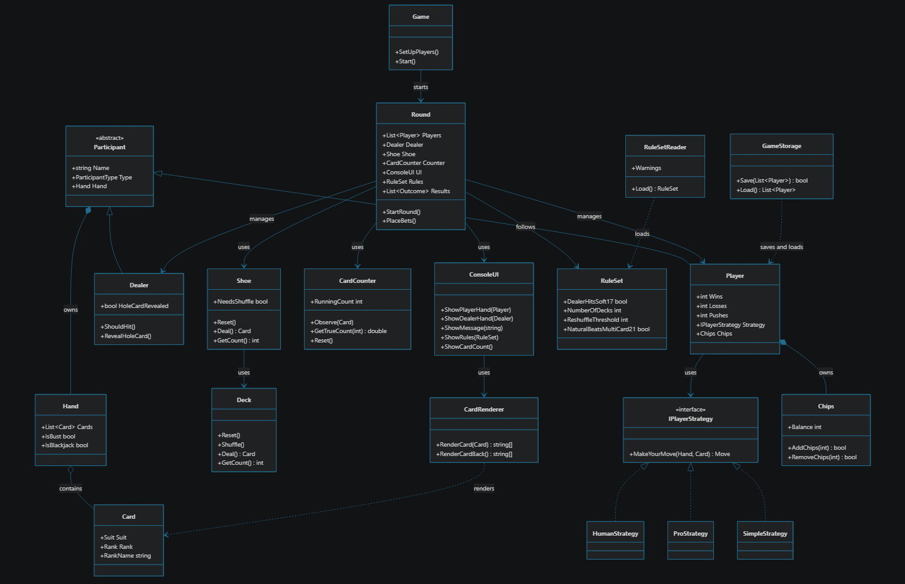

# Designbeslut

### Ska card ha value?
Ja, card har value 2-9 har sig själv som value, 10-kung har 10 som value och ess har 1 eller 11 beroende på vad som inte spräcker.  

### Är dealer en spelare?
Nej, dealern ska inte räknas som spelare.  

### Vem bestämmer vad en spelare gör?
ConsoleUI.  

### Var ligger givarens regler?
Regler för givaren ska ligga under dealer.


### Hur du startar programet

Du startar genom att köra dotnet run 
```C#
public class Program
{
    static void Main(string[] args)
    {
        Game game = new Game();
        game.Start();
    }
}
```
### Översikt över klasserna
----

1. Programmet är uppdelat i flera klasser som tillsammans hanterar spelets logik, korten och användargränssnittet.
2. Card: Representerar ett spelkort med en valör och en färg.
3. Deck / Shoe: Hanterar kortleken och de kort som används under spelets gång.
4. Hand: Innehåller en deltagares kort och beräknar handens totala värde.
5. Player: Representerar en spelare som deltar i spelet.
6. Dealer: Representerar dealern och hanterar dealerns roll i spelet.
7. Round: Samordnar de olika momenten i en spelrunda och kopplar samman spelets olika delar.
8. CardRenderer: Skapar den grafiska representationen av spelkort i konsolen.
9. ConsoleUI: Hanterar kommunikationen med användaren och visar information i konsolen.

Klasserna har olika ansvarsområden men samarbetar för att spelet ska fungera. 


__Peter tillval 1__
kortgrafik i konsolen: 
Gör så att korten reprensenteras i konsolen 
med ram, suit, rank.

Daria tillval: 2

Philip tillval: 3

Felix tillval: 4

Hamed tillval: 5


Vi har inte avvikigt från uppgiftens och spelets grundkrav.

### __Klassdiagram__





